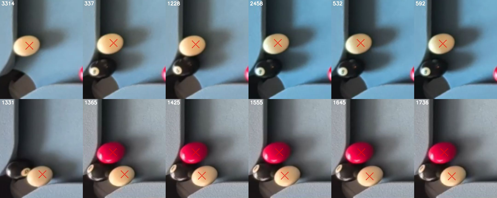

# Cue handover from the colour-peak stage

11 November 2026, branch `claude/live-detect-d1-d3`. Follows the
[second miss spot diagnosis](miss-spot-2-diagnosis.md). Scored on desktop with
the T2 runner ([t2-desktop-parity.md](t2-desktop-parity.md)).

**Target test:** the cue at the cushion near (0.062, 0.868) in Layout03 frames
382, 1274 and 3360. **Before:** cue 25/28 on the 35 labelled frames, missed in
all three; the packed-yellow stage fitted it at 0.875 to 0.938 and classified
it `cue`, then discarded it. **Intended:** 28/28 with no false cue and no other
change.

## Result

| 35 labelled frames, desktop, production settings | Before | After |
|---|---|---|
| Balls found | 529/546 | **532/546** |
| Cue found | 25/28 | **28/28** |
| False positives | 0 | 0 |
| Colour accuracy | 0.996 | 0.996 |
| Frames fully correct | 19/35 | **20/35** |
| Max centre error (ball diameters) | 0.233 | 0.233 |

Only 382, 1274 and 3360 change. Each gains the cue, 7 to 9 px from the label
(a ball is about 43 px across at width 800). No other ball moves and no
uncertainty flag changes. None of the 7 cue-absent labelled frames (477, 206,
562, 295, 395, 1587, 962) gets a cue.

On the 438 unlabelled manifest frames (no labels, so no score), 34 change,
all from no cue to one cue. Nothing else changes: no other ball moves and no
warning is added. All 34 lose "No unique cue ball reference", since colour
normalisation now has a reference; one also clears its pocket warning and
layout flag. No frame gains a flag. The new cues sit at two neighbouring spots,
about (0.06 to 0.07, 0.86) and (0.08 to 0.10, 0.94). Twelve sampled by eye
are all real cue balls:

Red crosses are the detector's balls after the change. Top row: the cushion
spot; bottom row: the cue beside the black near the corner pocket, where the
black is still missed (D3).

## Rule

Behind `VisionSettings.PackedCueHandover` (default on); the algorithm identity
gains `-cuehandover75`, and off reproduces the old identity and output.

1. The red/yellow colour-peak stage (`PackedBallClusterRecovery.FindColourPeakBodies`)
   still keeps only its own colour. A body that classifies as `cue` with fit
   support at least `MinimumHoughBoundarySupport` (0.75) is set aside instead
   of discarded, after a neutral boundary refit (no expected colour, as cue
   recovery fits) that must also reach 0.75 and still classify as `cue`.
2. After Hough, `Detect` selects it only if it is the one distinct such body,
   no other body sits within the separation distance, and no other body
   classifies as the cue.
3. `Analyze` admits it only if the first pass has no cue and neutral cue
   recovery also recovered none. It is marked as a cue the same way recovered
   cue bodies are.

Why the last two steps. A first version added the cue inside `Detect`. It
pre-empted cue recovery, which fits better: on 2083 the cue moved from 0.6 px
to 10.6 px from its label. On 16 unlabelled frames, mostly pocket-lip
fixtures (code60 to code64), it also raised the pocket-colour flag and the
layout flag on a cue that recovery had already found. A second version refitted neutrally, which fixed 2083 but not
the pocket flags. Deferring the handover until cue recovery has failed
removes both: every frame where a cue was already found is now unchanged.

Audit decisions, visible through `SkyEye.Vision.Desktop.Runner audit`:
`deferred-cue-handover`, `rejected-cue-handover-neutral-refit`,
`rejected-ambiguous-cue-handover`, `rejected-duplicate`,
`rejected-cue-already-present`, `pending-until-cue-recovery`,
`added-cue-handover`, `not-needed-cue-found`.

## Checks and limits

- Software, newly executed after the change: `Build-SkyEye.ps1 -Target All`
  0 errors, no warnings in the changed files; `SkyEye.Checks` and
  `SkyEye.AgentUi.Checks` pass. Layout03 parity with the handover off still
  reproduces the old device proofs, PASS 4/4.
- No unit check: the stage needs OpenCV, which `SkyEye.Checks` does not load.
  Coverage is the desktop scoring above; rerun `detect` after any change here.
- Desktop OpenCV 4.13 on PNG frames; not run on the device.
- The new cues are 7 to 9 px from their labels, against about 1 to 3 px for
  cues found by recovery. Good enough to identify the cue and normalise
  colours; less exact for aiming.
- Detector inventory 0/3 and physical gates 0/3 carried forward: the black
  is still missed beside several of these cues.

Regenerate:

    dotnet run --project tests\SkyEye.Vision.Desktop.Runner -- detect --manifest tests\fixtures\detection-corpus\manifest.json --output work\t2\cue-before.jsonl --settings work\t2\settings-production-no-cue-handover.json --threads 4
    dotnet run --project tests\SkyEye.Vision.Desktop.Runner -- detect --manifest tests\fixtures\detection-corpus\manifest.json --output work\t2\cue-after.jsonl --threads 4
    python tools/evidence/score_detections.py --manifest tests/fixtures/detection-corpus/manifest.json --detections work/t2/cue-after.jsonl --name cue-after

(`settings-production-no-cue-handover.json` is
`{"Width": 800, "PackedColourBoundarySearchExtentFraction": 0.65, "PackedCueHandover": false}`.)
