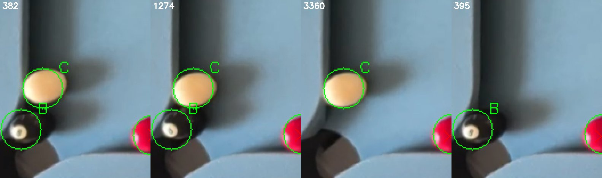

# Second miss spot: cue at the cushion, black in the corner pocket

11 November 2026, branch `claude/live-detect-d1-d3`. Found by the T2 `detect`
run ([t2-desktop-parity.md](t2-desktop-parity.md)): four Layout03 normal-train
frames that had no stored result (382, 1274, 3360, 395; bright light, table V
126 to 127) miss the cue near (0.062, 0.868) or the black near (0.03, 0.928).

**Target test:** which detector stage drops each ball. **Before:** cue missed
in 382, 1274 and 3360; black missed in 382, 1274 and 395; cause unknown.
**Outcome:** both causes found. Diagnostic only; no detector change.

Green circles are the reviewed labels (C cue, B black), red crosses the
detector's published balls. Table region x 0 to 0.22, y 0.74 to 1.0; made with
`tools/evidence/crop_table_region.py`.

## Cue: found, correctly classified, then discarded by a stage rule

In 382, 1274 and 3360 the cue is a plainly visible cream ball against the
cushion. The candidate audit (`SkyEye.Vision.Desktop.Runner audit`) shows:

| Frame | Stage | Fit support | Classified | Decision |
|---|---|---|---|---|
| 382 | packed-yellow | 0.938 | cue | rejected-classification |
| 1274 | packed-yellow | 0.875 | cue | rejected-classification |
| 3360 | packed-yellow | 0.938 | cue | rejected-classification |
| 3360 | hough | 0.719 | - | rejected-insufficient-boundary-support (gate 0.75) |

The warm cream cue falls inside the yellow colour mask, so the packed-colour
recovery proposes it and fits it well, above the 0.75 Hough gate. That stage
keeps only bodies classified as the colour it searches for
(`PackedBallClusterRecovery.cs:440`), so a correctly classified cue is
dropped. No other stage proposes it, except one Hough candidate in 3360 just
under the gate. With no cue found, colour normalisation has no reference
("No unique cue ball reference" warning on all three frames), which is the
same condition that made the cue read as yellow on 957 and 2263 (T5).

This looks fixable without touching any gate: hand a well-fitted body that
classifies as `cue` from the packed-colour stage to the cue path when no cue
has been accepted. It must be scored for false cues on the cue-absent frames
(Layout03 962, the empty controls) before it is kept. Not implemented.

## Black: half its outline lies over the dark pocket

In 382, 1274 and 395 the black sits in the corner pocket mouth. Its lower half
lies over the dark pocket opening, so that part of the outline has no edge.
Only the number patch and the upper rim stand out. The black recovery
candidates fail the boundary gate:

| Frame | Black present | Best `sparse-black-add` support | Decision |
|---|---|---|---|
| 395 | yes | 20/32 | rejected-insufficient-boundary-support (gate 21/32) |
| 382 | yes | 19/32 | rejected-insufficient-boundary-support |
| 1274 | yes | 19/32 | rejected-insufficient-boundary-support |
| 3360 | no (empty jaw) | 16/32 | rejected-insufficient-boundary-support |

It is not the pocket exclusion, as I had guessed; the probes put the
candidates 2.4 to 4.3 ball radii from the pocket point. The empty jaw in 3360
reaches 16/32, close to the 19 to 20 of the real black. This is the same
family as the cushion black at (1.48, 0.067): single-frame edge evidence
cannot cleanly separate a black against a dark opening from an empty one, and
the plan rules out lowering the 21/32 gate. It belongs to D3 (change between
settled frames) and permanence, not to a single-frame fix.

## Tools added

- `SkyEye.Vision.Desktop.Runner audit --manifest M --names 382 --at x,y [--at x,y] [--within 0.05]`:
  lists every candidate near a table point with its stage, fit support,
  classification and decision.
- `tools/evidence/crop_table_region.py`: warps manifest frames to a landscape
  table image, marks labels and detections, and tiles crops.

Frame names 382 and 1274 also match two unrelated JPEG frames in the older
o08 corpus; `audit` prints them too. Only the Layout03 PNG rows are discussed
here.

Detector inventory 0/3 and physical gates 0/3 carried forward. Camera not
touched.
