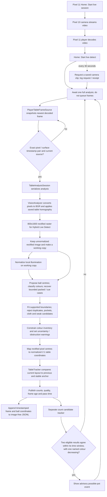

# Live Detect image and state pipeline

This is a code-traced guide to the Production companion's **Live Detect** path. It records the code state inspected on 29 October 2026. The detector starts with decoded camera pixels and applies the saved table perspective transform itself; it does not analyze the already displayed, perspective-corrected screen image.

## End-to-end flow

`Start live session` starts the camera path; `Start live detect` requires that session and saved calibration and never starts capture itself. Live Detect does not need a match, run shot planning, write to `GameState`, or confirm a pot. The clip-save timer is a side branch and does not change the image-analysis result.

## Perspective correction and image branches

1. **Frame acquisition:** [`PlayerTableFrameSource`](../src/SkyEye.Companion/PlayerTableFrameSource.cs) snapshots the newest decoded player texture. It requires an exact SurfaceTexture/release timestamp pair, records frame ID, source PTS, dimensions and age, and rejects a changed or uncontrolled camera source.
2. **Admission:** [`TableAnalysisSession`](../src/SkyEye.Core/Analysis/TableAnalysisSession.cs) allows one analyzer pass at a time. It binds the pass to the admitted camera source, calibration and generation, then discards a result if those changed before completion.
3. **Rectification:** [`VisionAnalyzer.AnalyzePixelsCore`](../src/SkyEye.Vision.Android/VisionAnalyzer.cs) calls `Warp(source, calibration)` for every frame. `Warp` converts the four saved normalized image corners to source pixels, computes an OpenCV perspective transform and warps the image to the analysis raster. With the current Hybrid Live Detect construction, that raster is 800 by 1600; the standalone `VisionAnalyzer` default is 1000 by 2000.
4. **Two rectified image versions:** the analyzer retains the perspective-warped image before illumination adjustment (`rawWarped`) and makes a copy that can receive local illumination normalization (`warped`). It derives HSV and masks from these branches. The main detector receives normalized HSV, while selected body/boundary support inputs use the raw or normalized rectified branch according to diagnostic settings. This is why `UseNormalizedGeometryForDetection = false` does **not** mean “no perspective correction”; it selects the unnormalized rectified support image. The name `rawWarped` means raw lighting, not raw camera perspective.
5. **Candidates and checks:** the detector combines Hough and colour-body proposals with bounded packed-rack and cue recovery. It checks pocket exclusions, cloth contrast, duplicates and fitted boundary support; it constrains colour inventory and marks unresolved counts, overlaps, weak boundaries, pocket ambiguity and obstructions uncertain. Those gates can keep the layout untrusted even when some balls were found.
6. **Coordinates:** detected centre pixels are in the rectified analysis raster. [`AnalysisCoordinates.ToTable`](../src/SkyEye.Core/Analysis/AnalysisCoordinates.cs) converts them to normalized table coordinates with long-axis range 0–2 and short-axis range 0–1. They are not camera-image pixels. Overlay code that draws a detector centre on the original camera image must apply the matching inverse calibration transform and source dimensions exactly once.
7. **Readiness and events are separate:** [`TableTracker`](../src/SkyEye.Core/Analysis/TableTracker.cs) checks repeated layout agreement, timing, uncertainty and obstruction to establish a settled table. The Live Detect count tracker separately emits a possible count-decrease event only from eligible repeated inventories. That event is advisory and does not write match history.

The phone's live-view correction is a separate rendering path (`SceneProjection` / TextureView transform). It can make the displayed table look rectangular without running ball detection. Live Detect does not read pixels back from that corrected display; it snapshots decoded pixels and applies the saved calibration inside `VisionAnalyzer`, avoiding dependence on UI layout or accidental double-warping.

## Has the analyzer always rectified?

Yes, for the committed C# `VisionAnalyzer` path. The first analyzer commit, `a7c8bcd` (3 October 2026), already called `Warp(source, calibration)` and used OpenCV `WarpPerspective`; the current code retains that step. This says what this repository's analyzer has done since its introduction, not what an earlier separate prototype may have done.

Rectification is generally useful here because it puts the table into a consistent coordinate system and makes ball scale/shape checks more uniform. It is not automatically more accurate in every image: a bad or stale corner calibration shifts every mapped centre, and interpolation can soften a ball edge. The right choice for detection accuracy must be measured against reviewed raw-frame labels and a held-out set. The current visual centre discrepancy must be resolved before relying on a small aggregate score.

## Handoff: centre-overlay discrepancy still open

- The user reviewed the 29 October holdout overlay and said **cyan was closer** to the centres. They then supplied a cropped overlay and said the **magenta crosses look about one ball width out**. Preserved crop: [`user-reviewed-cross-offset-crop.png`](../work/production/evidence/o08-holdout-20261029/raw-session-e3c02bb9dc4542948c829a512630041a/user-reviewed-cross-offset-crop.png).
- Keep this visual report in tension with the previous per-frame score (16/16 same-colour matches, reported max around 0.16 ball diameters). Do not dismiss the image based on that aggregate: first identify which full overlay/source frame the crop came from and verify the draw transform and point correspondence.
- Audit, from the exact source receipt and calibration used by v21: (a) detector centre in rectified pixels, (b) its `ToTable` result, (c) the overlay's inverse transform back to source pixels, and (d) manual/source centre for the same physical ball. Confirm each transform and corner order is applied once. Report displacement in source pixels and ball diameters per ball; do not use nearest-same-colour matching as the only validation if rack positions provide correspondence.
- Compare full-resolution raw source and overlay side by side. Check that the overlay has the exact source pixel hash, frame receipt and calibration ID expected. A one-ball-width systematic offset points first to wrong frame/calibration, corner ordering, axis/origin, scaling, or double/missing transform; detector threshold tuning should wait until those are ruled out.
- Earlier score and overlay artifacts are under `work/production/evidence/o08-holdout-20261029/raw-session-e3c02bb9dc4542948c829a512630041a/`. The four-light replay overlay is a different artifact and uses class colours; do not conflate its magenta class marks with the holdout overlay's magenta detector marks.
- The still-table goal remains active until independently reviewed positions and readiness work across the supported lighting are reliable. The user asked to pause it during model switch; it is paused at this handoff.

## Code anchors

- Home shortcut: [`Routes.razor`](../src/SkyEye.Companion.Hybrid/Components/Routes.razor) → `ToggleLiveDetect` → [`ShellLiveDetect.cs`](../src/SkyEye.Companion.Hybrid/ShellLiveDetect.cs) `ToggleLiveDetectAsync` / `RunLiveDetectAsync`.
- Hybrid analyzer width: [`ShellTable.cs`](../src/SkyEye.Companion.Hybrid/ShellTable.cs) `InitializeTable` (800 px width).
- Frame pixels and timestamp pairing: [`PlayerTableFrameSource.cs`](../src/SkyEye.Companion/PlayerTableFrameSource.cs) `TryReadFrameOnce`.
- Frame admission/tracker update: [`TableAnalysisSession.cs`](../src/SkyEye.Core/Analysis/TableAnalysisSession.cs) `RunUpdateAsync`.
- Warp and detector image branches: [`VisionAnalyzer.cs`](../src/SkyEye.Vision.Android/VisionAnalyzer.cs) `AnalyzePixelsCore` / `Warp`.
- Rectified-pixel to table-coordinate conversion: [`AnalysisCoordinates.cs`](../src/SkyEye.Core/Analysis/AnalysisCoordinates.cs) `ToTable`.
- Still-layout decision: [`TableTracker.cs`](../src/SkyEye.Core/Analysis/TableTracker.cs) `Observe` / `SameLayout`.
- Advisory count event and logging: [`LiveDetectCountCandidateTracker.cs`](../src/SkyEye.Companion.Hybrid/LiveDetectCountCandidateTracker.cs), [`LiveDetectLogStore.cs`](../src/SkyEye.Companion.Hybrid/LiveDetectLogStore.cs), and `ShellLiveDetect.cs`.
