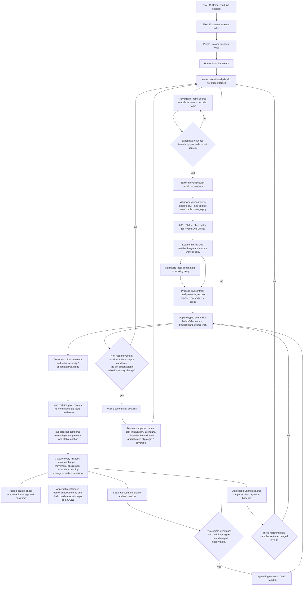

# Live Detect image and state pipeline

This is a code-traced guide to the Production companion's **Live Detect** path. It records the code state inspected on 29 October 2026. The detector starts with decoded camera pixels and applies the saved table perspective transform itself; it does not analyze the already displayed, perspective-corrected screen image.

## End-to-end flow

`Start live session` starts the camera path; `Start live detect` requires that session and saved calibration and never starts capture itself. Every full pass is recorded with its `checkOutcome`, while typed events mark meaningful transitions. Live Detect does not need a match, run shot planning, write to `GameState`, or confirm a pot. Event clips start only after a qualifying settled result; there is no periodic timer clip.

## Perspective correction and image branches

1. **Frame acquisition:** [`PlayerTableFrameSource`](../src/SkyEye.Companion/PlayerTableFrameSource.cs) snapshots the newest decoded player texture. It requires an exact SurfaceTexture/release timestamp pair, records frame ID, source PTS, dimensions and age, and rejects a changed or uncontrolled camera source.
2. **Admission:** [`TableAnalysisSession`](../src/SkyEye.Core/Analysis/TableAnalysisSession.cs) allows one analyzer pass at a time. It binds the pass to the admitted camera source, calibration and generation, then discards a result if those changed before completion.
3. **Rectification:** [`VisionAnalyzer.AnalyzePixelsCore`](../src/SkyEye.Vision.Android/VisionAnalyzer.cs) calls `Warp(source, calibration)` for every frame. `Warp` converts the four saved normalized image corners to source pixels, computes an OpenCV perspective transform and warps the image to the analysis raster. With the current Hybrid Live Detect construction, that raster is 800 by 1600; the standalone `VisionAnalyzer` default is 1000 by 2000.
4. **Two rectified image versions:** the analyzer retains the perspective-warped image before illumination adjustment (`rawWarped`) and makes a copy that can receive local illumination normalization (`warped`). It derives HSV and masks from these branches. The main detector receives normalized HSV, while selected body/boundary support inputs use the raw or normalized rectified branch according to diagnostic settings. This is why `UseNormalizedGeometryForDetection = false` does **not** mean “no perspective correction”; it selects the unnormalized rectified support image. The name `rawWarped` means raw lighting, not raw camera perspective.
5. **Candidates and checks:** the detector combines Hough and colour-body proposals with bounded packed-rack and cue recovery. It checks pocket exclusions, cloth contrast, duplicates and fitted boundary support; it constrains colour inventory and marks unresolved counts, overlaps, weak boundaries, pocket ambiguity and obstructions uncertain. Those gates can keep the layout untrusted even when some balls were found.
6. **Coordinates:** detected centre pixels are in the rectified analysis raster. [`AnalysisCoordinates.ToTable`](../src/SkyEye.Core/Analysis/AnalysisCoordinates.cs) converts them to normalized table coordinates with long-axis range 0–2 and short-axis range 0–1. They are not camera-image pixels. Overlay code that draws a detector centre on the original camera image must apply the matching inverse calibration transform and source dimensions exactly once.
7. **Readiness and events are separate:** [`TableTracker`](../src/SkyEye.Core/Analysis/TableTracker.cs) checks repeated layout agreement, timing, uncertainty and obstruction to establish a settled table. `StableTableChangeTracker` independently compares clear before/after layouts; the Live Detect count tracker confirms eligible repeated decreases, increases and mixed changes. Every full pass still has a check outcome when the layout is unchanged or uncertain. A full rack event additionally requires repeated complete packed-rack evidence. These observations do not write match history; decreases remain possible-pot candidates.

The phone's live-view correction is a separate rendering path (`SceneProjection` / TextureView transform). It can make the displayed table look rectangular without running ball detection. Live Detect does not read pixels back from that corrected display; it snapshots decoded pixels and applies the saved calibration inside `VisionAnalyzer`, avoiding dependence on UI layout or accidental double-warping.

## Has the analyzer always rectified?

Yes, for the committed C# `VisionAnalyzer` path. The first analyzer commit, `a7c8bcd` (3 October 2026), already called `Warp(source, calibration)` and used OpenCV `WarpPerspective`; the current code retains that step. This says what this repository's analyzer has done since its introduction, not what an earlier separate prototype may have done.

Rectification is generally useful here because it puts the table into a consistent coordinate system and makes ball scale/shape checks more uniform. It is not automatically more accurate in every image: a bad or stale corner calibration shifts every mapped centre, and interpolation can soften a ball edge. The right choice for detection accuracy must be measured against reviewed raw-frame labels and a held-out set. The current visual centre discrepancy must be resolved before relying on a small aggregate score.

## Centre-overlay discrepancy resolved: 29 October review

- The user reviewed the 29 October holdout overlay and said **cyan was closer** to the centres. They then supplied a cropped overlay and said the **magenta crosses look about one ball width out**. Preserved crop: [`user-reviewed-cross-offset-crop.png`](../work/production/evidence/o08-holdout-20261029/raw-session-e3c02bb9dc4542948c829a512630041a/user-reviewed-cross-offset-crop.png).
- The crop is visibly from the holdout overlay above. The earlier uncertainty about which image the user meant was incorrect.
- The original drawing command was recovered from this chat's session record. Its inverse homography used `(f*g-d*h)*x` in the source-Y numerator. The correct cofactor is `(f*g-d)*x`. That extra `h` shifted the plotted points down by 15.39–61.09 source pixels (mean 55.57); the rack therefore appeared displaced by about a ball diameter. This was a diagnostic overlay defect, not a change in the saved detector coordinates. The original bad image is retained as evidence.
- [`Compare-ManualVisionCentres.ps1`](../scripts/Compare-ManualVisionCentres.ps1) solves forward and reverse transforms independently, validates source/receipt/label/replay hashes, checks corner mappings and centre round trips, and reads detector coordinates directly from the exact replay. It writes a new `*-corrected.png` full overlay, object-ball crop and per-point JSON audit without overwriting the old overlay or modifying labels.
- Corrected raw-pixel comparison to the existing draft labels: 800px analyzer mean 2.919px / max 7.306px; 1000px analyzer mean 3.004px / max 7.602px, with 16 one-to-one same-colour matches at each width. Reverse corner mapping error is below 0.000001px. Visual inspection confirms the large rack displacement has disappeared. These measurements apply to this frame and approximate labels, whose review status remains provisional.
- Corrected images and JSON are beside the original artifacts under `work/production/evidence/o08-holdout-20261029/raw-session-e3c02bb9dc4542948c829a512630041a/`. This repair changes the evidence presentation only; it does not establish event accuracy or cross-session acceptance.
- The goal was resumed after the model switch. Follow the dedicated [Live Detect delivery plan](live-detect-plan.md) for current work, acceptance evidence and remaining defects.

## Code anchors

- Home shortcut: [`Routes.razor`](../src/SkyEye.Companion.Hybrid/Components/Routes.razor) → `ToggleLiveDetect` → [`ShellLiveDetect.cs`](../src/SkyEye.Companion.Hybrid/ShellLiveDetect.cs) `ToggleLiveDetectAsync` / `RunLiveDetectAsync`.
- Hybrid analyzer width: [`ShellTable.cs`](../src/SkyEye.Companion.Hybrid/ShellTable.cs) `InitializeTable` (800 px width).
- Frame pixels and timestamp pairing: [`PlayerTableFrameSource.cs`](../src/SkyEye.Companion/PlayerTableFrameSource.cs) `TryReadFrameOnce`.
- Frame admission/tracker update: [`TableAnalysisSession.cs`](../src/SkyEye.Core/Analysis/TableAnalysisSession.cs) `RunUpdateAsync`.
- Warp and detector image branches: [`VisionAnalyzer.cs`](../src/SkyEye.Vision.Android/VisionAnalyzer.cs) `AnalyzePixelsCore` / `Warp`.
- Rectified-pixel to table-coordinate conversion: [`AnalysisCoordinates.cs`](../src/SkyEye.Core/Analysis/AnalysisCoordinates.cs) `ToTable`.
- Still-layout decision: [`TableTracker.cs`](../src/SkyEye.Core/Analysis/TableTracker.cs) `Observe` / `SameLayout`.
- Live Detect event reducer and logging: [`LiveDetectTableEventTracker.cs`](../src/SkyEye.Companion.Hybrid/LiveDetectTableEventTracker.cs) `Observe` (one fresh observation in, check outcome and typed events out), [`LiveDetectCountCandidateTracker.cs`](../src/SkyEye.Companion.Hybrid/LiveDetectCountCandidateTracker.cs), [`LiveDetectLogStore.cs`](../src/SkyEye.Companion.Hybrid/LiveDetectLogStore.cs), and `ShellLiveDetect.cs` (I/O and clip scheduling). The reducer is transient and does not write canonical `GameState`; see the [state-machine boundary and replay results](live-detect-plan.md#state-machine-boundary).
